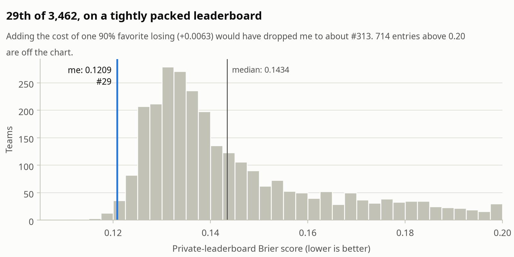
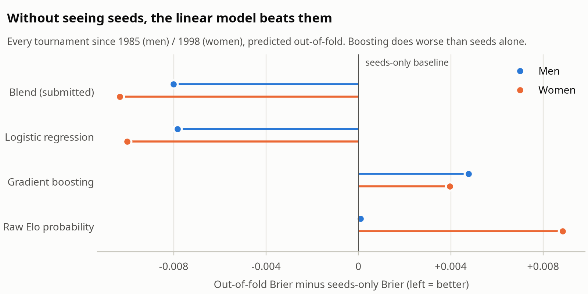
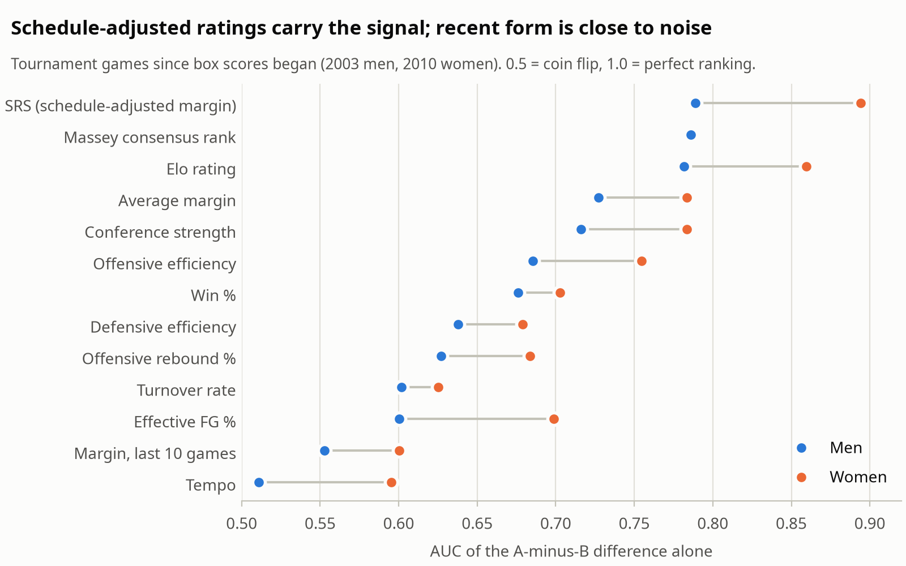
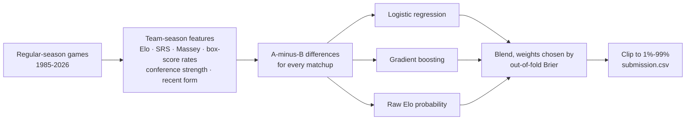

# March Machine Learning Mania 2026: 29th of 3,462

Predict the chance that any Division I basketball team beats any other, men's and women's, before the NCAA tournament starts. Scored by [Brier score](https://en.wikipedia.org/wiki/Brier_score) on the 126 games that were actually played.

**Brier 0.1209 · 29th of 3,462 (top 1%) · silver medal · one submission, made before the bracket was announced**

<picture>
  <source media="(prefers-color-scheme: dark)" srcset="figures/leaderboard-dark.png">
  
</picture>

## The idea

About 4,300 tournament games in 40 years is very little data, and March is noisy. So instead of a complex model:

1. **Rate every team from its regular season**, using measures that correct for who it played (Elo, SRS, the Massey consensus of public rankings), plus tempo-free box-score rates.
2. **Turn each matchup into A-minus-B differences**, so the model learns *relative* strength and can score any pair of teams, including the 132,000 matchups that never happen.
3. **Let held-out seasons choose the model.** Logistic regression, gradient boosting and a raw Elo probability were blended, with weights chosen by Brier score on 40 seasons of out-of-fold tournaments. The data picked 85-90% logistic regression, 10-15% Elo and **0% boosting**.

The model never sees seeds (I submitted two days before Selection Sunday), yet it beats a seed-based model on 40 years of tournaments:

<picture>
  <source media="(prefers-color-scheme: dark)" srcset="figures/ablation-dark.png">
  
</picture>

| Out-of-fold Brier (lower is better) | Men | Women |
|---|---|---|
| Seeds only (baseline) | 0.1901 | 0.1503 |
| Gradient boosting | 0.1949 | 0.1543 |
| Logistic regression | 0.1823 | 0.1403 |
| **Blend (submitted)** | **0.1821** | **0.1400** |

## What the data said

<picture>
  <source media="(prefers-color-scheme: dark)" srcset="figures/signal-dark.png">
  
</picture>

- **Ratings that adjust for schedule carry the signal.** SRS, Massey and Elo lead every raw stat. "Hot team" form over the last 10 games is close to a coin flip.
- **Those three ratings are one signal.** They correlate at 0.90-0.95, which favors a regularized linear model over trees.
- **The women's bracket is chalkier.** A 12 seed beats a 5 in 36% of men's games but only 20% of women's, so each gets its own model.
- **One season's luck outweighs any model choice.** The same model's Brier swings ±0.02 from year to year, twice its edge over seeds. So every decision was made on 40 seasons of held-out predictions, never on one leaderboard.

The full walkthrough is in **[march_mania_2026.ipynb](march_mania_2026.ipynb)**: eight charts, each answering one question, plus the 2026 games the model called and missed.

## How it works



## Run it

```bash
pip install -r requirements.txt
kaggle competitions download -c march-machine-learning-mania-2026 -p data && unzip -q data/*.zip -d data
python mania.py         # under 10 s; writes submission.csv for all 132,133 matchups
python test_mania.py    # sanity checks for the rating math
jupyter lab march_mania_2026.ipynb
```

`results/submitted_2026.csv` is the exact file that scored 0.1209. `python mania.py` retrains from scratch on Kaggle's current data release, so its output won't match that file byte for byte.

## Repository

| File | What it is |
|---|---|
| [`mania.py`](mania.py) | The whole pipeline: features, ratings, models, blend, submission |
| [`march_mania_2026.ipynb`](march_mania_2026.ipynb) | Data analysis, model evaluation and the 2026 results |
| [`results/submitted_2026.csv`](results/submitted_2026.csv) | The file submitted to Kaggle |
| [`results/actual_2026.csv`](results/actual_2026.csv) | The 126 scored 2026 games; scoring the file above against it reproduces 0.1208707 |
| [`results/leaderboard_2026.csv`](results/leaderboard_2026.csv) | Final leaderboard (rank and score only) |
| [`test_mania.py`](test_mania.py) | Checks for SRS, Elo and matchup symmetry |

[Competition](https://www.kaggle.com/competitions/march-machine-learning-mania-2026) · [Leaderboard](https://www.kaggle.com/competitions/march-machine-learning-mania-2026/leaderboard) · [MIT License](LICENSE)
