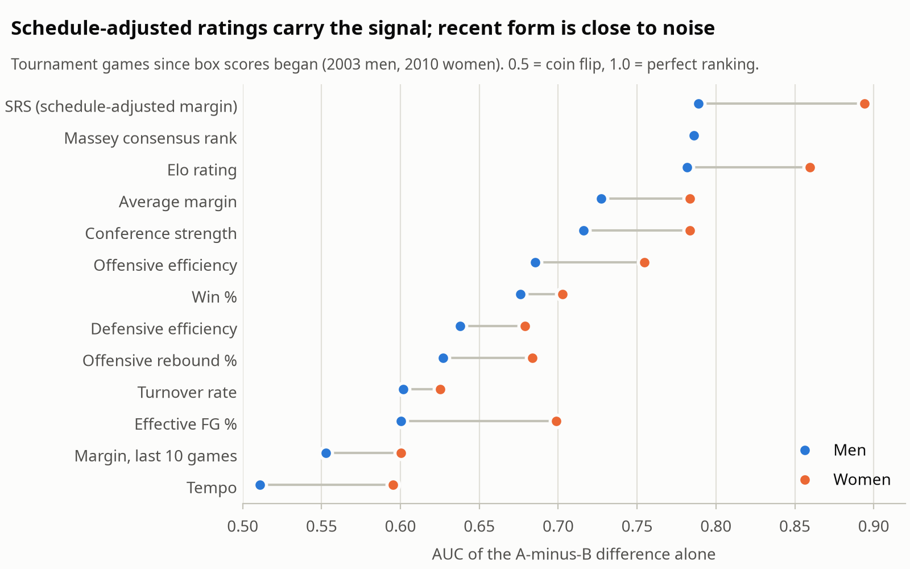
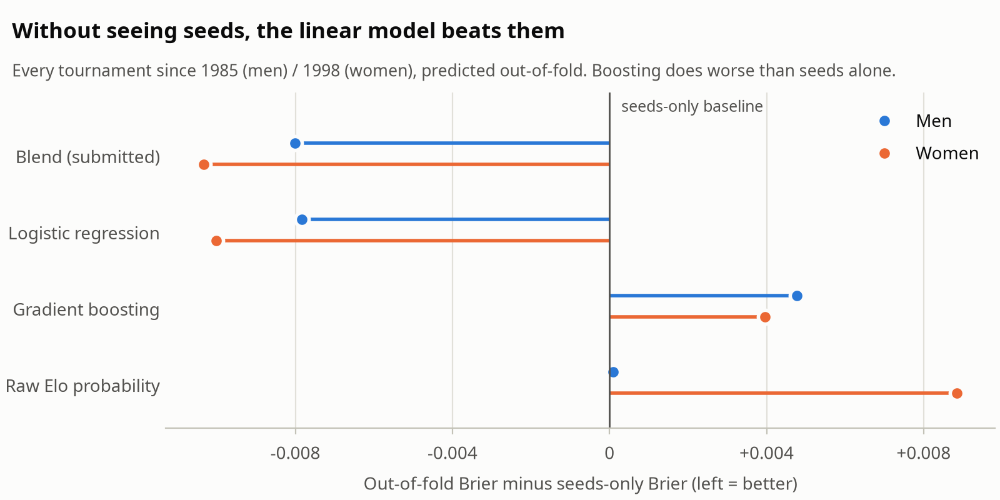
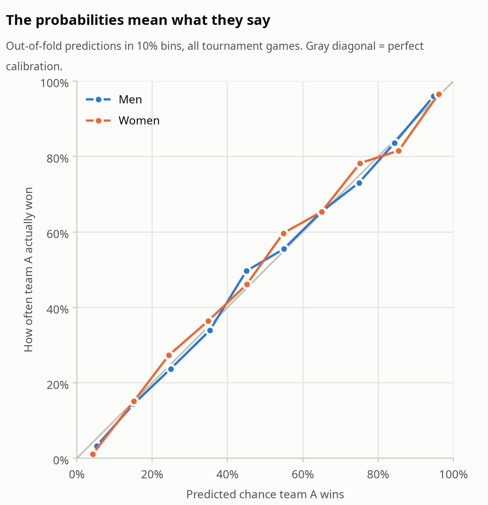
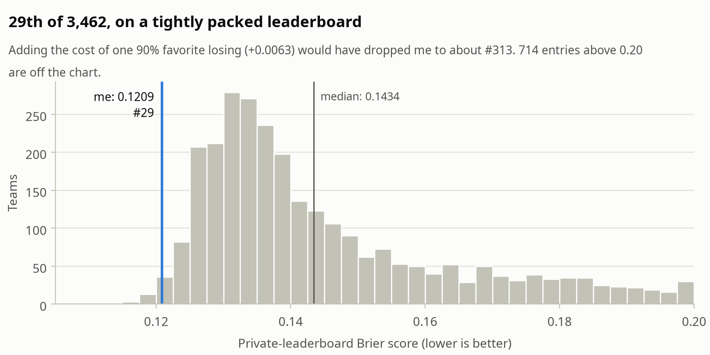
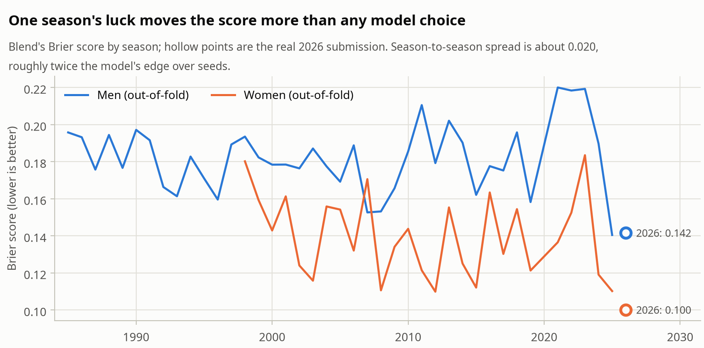

# March Machine Learning Mania 2026: 29th Place Solution

**Final score:** 0.1208707 (Brier, 126 games) · **Rank:** 29th of 3,462 teams (top 1%, silver medal) · **One submission**, made on March 13, two days before Selection Sunday

## Context

Competition: [March Machine Learning Mania 2026](https://www.kaggle.com/competitions/march-machine-learning-mania-2026)

Predict the probability that team A beats team B for every possible pairing of Division I teams, men's and women's: 132,133 matchups. Only the 126 tournament games actually played are scored, by Brier score (0.25 is a coin flip, lower is better).

| Data | Men | Women |
|---|---|---|
| Regular-season games | 198,577 (1985-2026) | 142,507 (1998-2026) |
| Tournament games to learn from | 2,585 | 1,717 |
| Box scores from | 2003 | 2010 |

## Philosophy

- **There is very little to learn from.** About 4,300 tournament games in 40 years, and March is noisy. That argues for few parameters and strong priors, not a deep model.
- **Rate the teams, then compare them.** Every matchup is a difference of two team ratings, so the model can price any pair, including the 132,000 that are never played.
- **Never trust one season.** The same model's Brier swings by ±0.02 from year to year, twice its edge over seeds. Every choice was made on 40 seasons of held-out tournaments, never on a leaderboard.
- **Men and women are separate problems.** The better seed wins 72% of men's games and 78% of women's; a 12 seed beats a 5 in 36% of men's games but only 20% of women's. Each gets its own model.

## Approach

### Data preparation

Winner/loser game rows become one row per team per game, then one row per team per season. Box-score features before 2003 (men) and 2010 (women) are filled with the season mean, so in those seasons the model has to lean on what final scores alone give: Elo, SRS, margin and win rate.

### Features

All features are team-season values, computed from the regular season only. Each matchup feature is **team A minus team B** (27 for men, 26 for women).

**Tempo-free box-score rates** (Dean Oliver's four factors and friends):

```python
df["Poss"] = df["FGA"] - df["OR"] + df["TO"] + 0.475 * df["FTA"]

OffEff = 100 * ScoreFor / Poss          # points per 100 possessions
DefEff = 100 * ScoreAgainst / Poss
eFG    = (FGM + 0.5 * FGM3) / FGA
TOV    = TO / Poss
ORB    = OR / (OR + Opp_DR)
FTR    = FTA / FGA
```

**Elo**, margin-aware, with home court and carry-over between seasons:

| Setting | Value | Why |
|---|---|---|
| Base | 1500 | |
| K | 20 | |
| Home-court bonus | 65 points | Home teams win 66% (men) and 61% (women) of non-neutral games; 65 points is a 59% expectation between equal teams |
| Carry-over | 75% of last season's rating, 25% regressed to 1500 | Rosters turn over |

```python
exp_w = 1 / (1 + 10 ** ((r[l] - r[w] - hca) / 400))
gap = r[w] + hca - r[l]
delta = K * log(max(margin, 1) + 1) * 2.2 / (abs(gap) * 0.001 + 2.2) * (1 - exp_w)
```

The log-margin term rewards blowouts with diminishing returns; the `gap` term shrinks the update when the two ratings are already far apart.

**SRS** (Simple Rating System): a team's rating is its average margin plus the average rating of its opponents, solved by 100 fixed-point iterations per season.

```python
r = np.bincount(team_idx, margin) / n
for _ in range(100):
    r = np.bincount(team_idx, margin + r[opp_idx]) / n
```

**Massey composite** (men only, as Kaggle has no women's ordinals): for each of the ~200 public ranking systems, take its last ranking before day 133, turn the rank into a percentile, and average across systems.

**Also:** win rate, points for and against, conference strength (mean SRS of the conference), season percentile of SRS and Elo, and form over the last 10 games.

### Which features carry the signal

<picture>
  <source media="(prefers-color-scheme: dark)" srcset="figures/signal-dark.png">
  
</picture>

- The three ratings that **adjust for schedule** (SRS, Massey, Elo) lead every raw stat: single-feature AUC around 0.79 for men and 0.86-0.89 for women.
- They are **one signal**: pairwise correlation 0.90-0.95. A regularized linear model can weigh correlated inputs without overreacting to any one; trees split on whichever happens to win.
- "Hot team" form, the margin over the last 10 games, is close to a coin flip (AUC 0.55 for men).

### Validation

`GroupKFold(n_splits=5)` grouped by season, so no tournament is ever split between train and validation. Every number below is Brier on out-of-fold tournament games: 40 men's seasons and 27 women's.

### Models and blend

Three predictors per gender:

```python
LogisticRegression(max_iter=500, C=1.0)
HistGradientBoostingClassifier(max_depth=3, learning_rate=0.05, max_iter=300, l2_regularization=0.1)
elo_prob = 1 / (1 + 10 ** ((B_Elo - A_Elo) / 400))   # no training
```

Blend weights were chosen by grid search (step 0.05) to minimize out-of-fold Brier. The data picked:

| | Logistic regression | Gradient boosting | Raw Elo |
|---|---|---|---|
| Men | 0.85 | **0.00** | 0.15 |
| Women | 0.90 | **0.00** | 0.10 |

<picture>
  <source media="(prefers-color-scheme: dark)" srcset="figures/ablation-dark.png">
  
</picture>

| Out-of-fold Brier (lower is better) | Men | Women |
|---|---|---|
| Seeds only (baseline) | 0.1901 | 0.1503 |
| Raw Elo probability | 0.1902 | 0.1592 |
| Gradient boosting | 0.1949 | 0.1543 |
| Logistic regression | 0.1823 | 0.1403 |
| **Blend (submitted)** | **0.1821** | **0.1400** |

The model never sees seeds, since I submitted before the bracket was announced, and still beats a seeds-only model by 0.008 (men) and 0.010 (women) over 40 seasons of held-out tournaments.

### Calibration

<picture>
  <source media="(prefers-color-scheme: dark)" srcset="figures/calibration-dark.png">
  
</picture>

Both curves track the diagonal, with 128-337 games per bin, so no calibration step was added on top.

## Post-processing

Predictions are clipped to [1%, 99%]. On 40 seasons this changes the score by less than 0.00001: it is insurance against a once-a-decade upset, not an edge. In 2026, 5 of the 126 games sat at the clip, and all 5 went the model's way.

Some top finishers "sharpened" confident picks instead, rounding everything past 97% to certainty. **Measured after the competition** on the same out-of-fold predictions:

| | Clipped (submitted) | Sharpened at 3% / 97% | Games affected | Upsets among them | Seasons where sharpening hurt |
|---|---|---|---|---|---|
| Men | 0.18214 | 0.18216 | 84 | 2 | 2 of 40 |
| Women | 0.13997 | 0.13993 | 234 | 0 | 0 of 27 |

Over many seasons it makes almost no difference. In a single year it is a variance bet: it pays when the favourites hold, as all 18 games at 97% or more did in 2026, and costs a lot when one doesn't.

## Results on the 2026 games

<picture>
  <source media="(prefers-color-scheme: dark)" srcset="figures/leaderboard-dark.png">
  
</picture>

Brier 0.1416 on the men's games and 0.1001 on the women's; 0.1209 overall against a leaderboard median of 0.1434. The 10 costliest games account for 35% of the total loss. The worst were real upsets the model priced low: (10) Virginia over (2) Iowa in the women's bracket at 10%, and (9) Iowa over (1) Florida at 19%.

<picture>
  <source media="(prefers-color-scheme: dark)" srcset="figures/by_season-dark.png">
  
</picture>

For scale: the same model scores anywhere from 0.14 to 0.22 on the men's side depending on the year. A 29th place is a good model plus a kind bracket, and the 40-season numbers above are the honest measure of the model.

## What didn't work

- **Gradient boosting.** Worse than seeds alone on both sides, and the blend gives it zero weight. With ~2,500 games and features that are mostly one signal, trees fit noise.
- **Standardizing the inputs.** Logistic regression on raw features stops at `max_iter` before converging, and that early stop acts as regularization. Standardized inputs scored worse in season-grouped cross-validation (men 0.1829 against 0.1822).
- **Raw Elo on its own.** No better than seeds for men (0.1902 vs 0.1901) and clearly worse for women (0.1592 vs 0.1503). It earns its 10-15% weight only as a second opinion in the blend.
- **Recent form.** Margin over the last 10 games is near a coin flip as a predictor; March rewards the whole season, not the last month.

## Mistakes and opportunities

- **Regularization by accident.** The early stop above works, but it is a side effect, not a setting. Next time: standardize and tune `C` on the same season folds, so the regularization is explicit and reproducible across library versions.
- **No seeds.** Submitting before Selection Sunday meant ignoring the bracket. The model beats seeds without them, but a second submission after the bracket, with seed difference as a feature, was a free option I didn't take.
- **Blend weights are chosen on the folds they are scored on.** With two free weights over thousands of games the optimism is small, but a nested split would remove it.
- **No outside data.** No injuries and no betting lines. The winner adjusted for injuries by hand; market odds price both injuries and matchups.
- **Women's side is thinner.** No Massey ordinals and box scores only from 2010, so the women's model runs on fewer signals for half its history.

## Sources

- Competition data: [Kaggle](https://www.kaggle.com/competitions/march-machine-learning-mania-2026/data)
- Code, analysis notebook and the exact submitted file: [github.com/garnikdavtian/march-mania-2026](https://github.com/garnikdavtian/march-mania-2026)
- SRS: the Simple Rating System popularized by Sports Reference
- Four factors: Dean Oliver, *Basketball on Paper* (2004)
